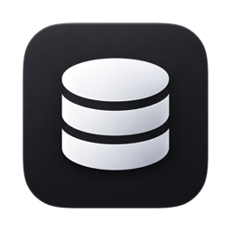
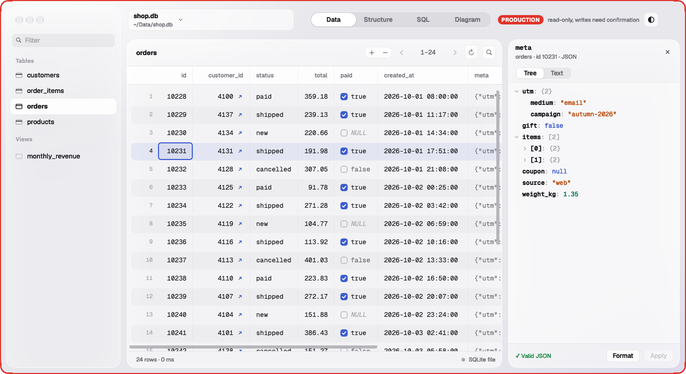
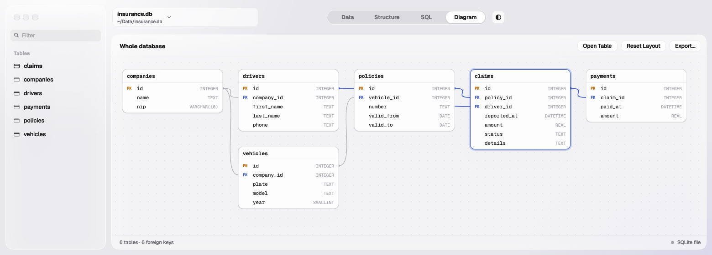

<p align="center">
  
</p>

<h1 align="center">PlainDB</h1>

<p align="center">
  <b>A small, native Postgres and SQLite client for macOS.</b><br>
  Browse tables, fix a value, run a query, see how it all connects. Locally or over SSH, without the clutter.
</p>

<p align="center">
  macOS · Objective-C / AppKit · PostgreSQL · SQLite · PocketBase · English &amp; Polish · MIT License
</p>

<p align="center">
  
</p>

PlainDB is written in Objective-C and AppKit, with no Electron and no web views. It's for quickly looking at what a database contains and fixing a value here and there: follow a foreign key to the row it points to, tick a boolean, pick a date from a calendar, edit a JSON value in a side panel, see the whole schema as a diagram. It opens Postgres servers, SQLite files and PocketBase's `data.db`, keeps several tables open in native tabs, and completes table and column names as you type SQL. Everything runs locally: no accounts, no cloud. Production connections are read-only until you confirm a write, and they are framed in a colour you pick, so you always know where you are.

## Features

### Connecting

- **Local databases** like in Postgres.app: a grid of databases on the local server, one click connects.
- **SQLite files**: open with ⌘O, from the Files tab of the Connections window (recent files), by dropping a file on it, or with "Open With" in Finder. The same grid, editing, search, SQL and diagram as for Postgres. Mark a file read-only to protect it like a production connection.
- **SQLite on a server, over SSH**, e.g. a production PocketBase: a saved connection of the type "SQLite over SSH" with the SSH host and the file's path on the server. Everything works as for a local file. See [SQLite over SSH](#sqlite-over-ssh).
- **PocketBase**: open its `pb_data/data.db` and the relations from `_collections` work like foreign keys (↗ previews, picking a record, ⌘F through them, diagram arrows; multi relations are dashed arrows). PocketBase manages its own schema, so schema editing is off there.
- **Saved connections** with passwords in the Keychain. Any connection, local databases included, can have a coloured frame around its window (8 colours or a custom one). Production connections always have one, plus a "PRODUCTION" badge in the title bar.
- **SSH tunnel** through the system `ssh`, so `~/.ssh/config`, keys, the agent and `ProxyJump` just work. The tunnel stays up and reconnects by itself; the status bar shows its state.
- **Switch database or connection** from the window: click the connection name in the toolbar for the other databases on the same server (also over SSH) and your saved connections.

### Browsing

- **Sidebar** with tables and views, with a filter and an estimated row count per table. Right-click a table to:
  - **pin** it to the top (remembered per connection and database);
  - open it in a new tab ("Open in New Tab");
  - see it with its neighbours on the diagram ("Show on Diagram");
  - **empty** it (`TRUNCATE`, or `DELETE` in SQLite, after typing its name).
- **Tabs**: "Open in New Tab" or ⌘-click a table to keep several tables of one connection open as native window tabs (a plain click still replaces the current table); "+" in the tab bar or ⌘T opens the current table again. Tabs share the connection, and they come back the next time you open that connection.
- **Data**: 200 rows per page with the table's total, row numbers, click a header to sort, numbers right-aligned. ⌘C copies the selected rows as tab-separated text.
- **Foreign keys**: a ↗ next to the value opens the referenced row in a popover. Editing the value opens a search in the referenced table: type a name, pick the row, and its key goes into the cell.
- **Find (⌘F or the magnifier)**: search every column of the whole table (not just the loaded page), ignoring case; matches are highlighted and counted. Foreign keys are followed one level: in `claims`, typing a driver's surname finds their claims, and the matching `driver_id` cells are highlighted. In the SQL editor ⌘F searches the query text.
- **Images** stored as `bytea`, base64, `data:` URIs or image URLs get a 🖼; click it to see the picture, its size and dimensions.
- **Files in S3 or PocketBase storage** get a 🖼 too: PocketBase file fields, and, once a connection has an S3 bucket in **S3 files** (bucket, region, AWS profile), values that look like keys of files in it (`pbc_123/abc/photo.jpeg`, Postgres arrays or JSON lists of them, `s3://bucket/key`). Images and PDFs open in a preview, anything else can be saved with "Save As…". Files are downloaded with your `aws` CLI and profile (SSO included), so PlainDB keeps no AWS keys; PocketBase files that aren't in S3 are read from `pb_data/storage`, also over SSH.
- **Structure**: columns, types, `NOT NULL`, defaults, primary key, indexes.

### Editing

- **Cells** (tables with a primary key):
  - double-click or Enter edits a cell, Esc cancels;
  - `+` adds a row, ⌫ deletes or restores the selected rows;
  - right-click gives "Set NULL", "Copy" and "Delete Row" (the whole selection when you right-click inside it; "Restore Row" on deleted rows);
  - changes are highlighted (yellow, green, red), summarised in a bar at the bottom and saved in one transaction with ⌘S.
- **Typed editing**: booleans show a checkbox that toggles with a click. `date`, `timestamp` and `timestamptz` open a calendar with a precise date and time field (`time` gets just the field); `timestamptz` is shown in your time zone and written with its offset.
- **JSON inspector**: double-click a cell holding a JSON object or array to open it in a side panel, as a tree (keys, typed and coloured values, item counts) or as highlighted text you can edit, format and apply. Key order is kept. While the panel is open, clicking another JSON cell shows that one.

### Diagram

<p align="center">
  
</p>

- Every table with its columns and foreign key arrows, referenced tables on the left. "Show on Diagram" in the sidebar (or a double-click on a box) shows just a table and its neighbours.
- Drag boxes (positions are remembered). Move around by dragging the background or with the middle mouse button; zoom with a pinch, ⌘ + mouse wheel (around the cursor) or ⌘+ / ⌘− / ⌘0. Export the whole diagram as PNG or PDF.
- A click only selects a box; open a table from its menu or with "Open Table".
- From the same menu, "Add Column…" and "Add Foreign Key…" show the exact SQL before running it in a transaction.

### SQL

- Editor with syntax highlighting and line numbers; ⌘R runs it, or only the selection.
- Completion while typing: tables after `FROM` / `JOIN`, a table's columns after `alias.` or `table.`, otherwise the statement's columns, tables, functions and keywords (↑↓, Tab or Enter, Esc; ⌃Space opens the list). It picks up tables you create or alter from the editor.

### Safety

- **Production mode**: frame and badge in the connection's colour, and a read-only session (`default_transaction_read_only` in Postgres, `PRAGMA query_only` for a read-only SQLite file). Writes need confirmation with a SQL preview, then run in one transaction that is allowed to write.
- **Unsaved changes**: switching table, page or sort order, closing the window or quitting asks whether to discard them.

### Settings

- ⌘, : interface language (system, English, Polski).

## Requirements

- macOS with Xcode or the Command Line Tools
- `libpq` from Homebrew: `brew install libpq` (SQLite ships with macOS)

## Building

```sh
make          # builds build/PlainDB.app
make run      # builds and opens it
make install  # builds and installs to /Applications/PlainDB.app
make test     # Postgres and SQLite layers, grid, diagram, completion and translation checks (PLAINDB_TEST_DB, default: postgres)
make perf     # grid scroll speed, CPU and memory on a big page (opens a window for a few seconds)
```

## SSH tunnel

Put `user@server` or an alias from `~/.ssh/config` in the **SSH tunnel** field. **Database host** is then the address as seen from the server, usually `localhost`.

PlainDB runs `ssh` in `BatchMode`, so it never asks for a password. You need a key (ideally in the agent), and the server must already be in `known_hosts`. If it isn't yet, connect to it once by hand from a terminal.

## SQLite over SSH

For an SQLite database that lives on a server, like a production PocketBase's `pb_data/data.db`. In **Saved**, set **Type** to "SQLite over SSH", then fill in the **SSH host** (`user@server` or an alias from `~/.ssh/config`) and the **File on server** (an absolute path).

PlainDB opens one `ssh` session and runs a small helper with the server's `python3` next to the file, so SQLite's locking works as usual and writing while PocketBase runs is safe. A network file system (SSHFS) is not: it can corrupt the database.

What the server needs:
- `python3` 3.6 or newer (Debian and Ubuntu have it);
- a user that can read and write the database file and its directory (SQLite keeps `-wal` and `-shm` files next to it). It doesn't need root.
- PocketBase in Docker: use the volume's path on the host, ideally a bind mount owned by that user, e.g. `/srv/pocketbase/pb_data/data.db`; a named volume lives under `/var/lib/docker/volumes/<name>/_data/`, which usually needs root.

How it stays safe:
- `ssh` runs as for tunnels: keys or the agent only (`BatchMode`), the server must already be in `known_hosts`, and PlainDB stores no SSH secret.
- The command run on the server is always the same; the helper and the path are sent through the encrypted session's input, so nothing you type reaches the remote shell. Nothing is installed or left on the server.
- Mark the connection **Production** and it's read-only on the server itself: the helper refuses writes, `ATTACH`, `VACUUM INTO` and changing pragmas, even typed in the SQL tab. A write you confirm runs in one transaction, and the session is read-only again right after it.

## Translations

UI strings are written in English in the code (`L(@"…")`, plurals with `LN(@"%lu rows", n)`). Polish lives in `Resources/pl.lproj/Localizable.strings` and `Localizable.stringsdict`. `make test` fails when a string is missing, unused, or its format specifiers don't match.

## Known limitations

- File previews need the AWS CLI (`brew install awscli`) for S3, are capped at 50 MB (20 MB from PocketBase storage), and can't show files the application encrypted itself.

- After each rebuild macOS may ask for Keychain access, because the app's signature changes. Choose "Always Allow".
- The SQL tab loads the whole result into memory. Add a `LIMIT` for huge tables.
- Long-running queries can't be cancelled.
- Foreign keys spanning several columns aren't shown (no ↗, no diagram arrow).
- SQLite can't add a foreign key to an existing table, so "Add Foreign Key…" is off for SQLite files.
- The schema of a PocketBase database is read-only in PlainDB; change it in PocketBase.
- Edits to a PocketBase database go straight to SQLite, so PocketBase's hooks, validation and realtime events don't see them.
- SQL completion follows simple rules, not a full SQL parser, so unusual statements may get generic suggestions.

Technical details: [docs/ARCHITECTURE.md](docs/ARCHITECTURE.md). Design decisions: [docs/DECISIONS.md](docs/DECISIONS.md).

## License

PlainDB is open source under the [MIT License](LICENSE): use it, change it, ship it, commercially or not. Keep the copyright notice.
